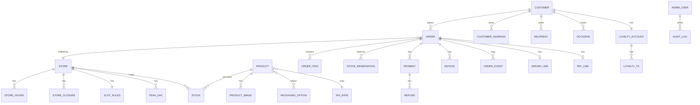

# Architektura, datový model a plán fází

## 1. Volba technologií

Zůstávám u výchozího návrhu ze zadání a doplňuji konkrétní knihovny. Kde volím jinak než „nejběžnější volba“, uvádím důvod.

| Oblast | Volba | Důvod |
|---|---|---|
| Aplikace | Next.js 15 (App Router), TypeScript, React Server Components | SSR pro SEO, jedna aplikace pro web i admin, nasazení na Vercel |
| Styly | Tailwind CSS 4 + vlastní design tokens | rychlý vývoj, tokeny podle schváleného směru |
| Databáze | Postgres na Neon (region Frankfurt) | serverless Postgres s brancho­váním pro preview, bez správy serveru |
| ORM | Drizzle ORM + drizzle-kit migrace | typově bezpečné a blízko SQL. Potřebuji `SELECT … FOR UPDATE`, advisory locky a transakce pro rezervaci skladu a kapacitu slotů; v Prismě je to těžkopádné |
| Fotky | Vercel Blob + ořez a zmenšení v prohlížeči před nahráním (HEIC z iPhonu převést) | nahrání z mobilu do 30 sekund i na horším signálu, obrázky přes `next/image` |
| Platby | Stripe (Payment Element + Express Checkout: karta, Apple Pay, Google Pay), za rozhraním `PaymentProvider` | zadání; rozhraní umožní výměnu |
| Mapy | Mapy.cz REST API (našeptávač, geokódování, routing) za rozhraním `GeoProvider`, s cache v Postgresu a záložní tabulkou PSČ | zadání |
| E-mail | Resend za rozhraním `MailProvider`, šablony React Email | vlastní doména, dobrá doručitelnost, jednoduché API |
| SMS | rozhraní `SmsProvider`, první implementace podle volby klientky (SMSbrána / GoSMS), ve vývoji „konzolový“ provider | zadání |
| Push do adminu | Web Push (service worker, PWA) + zvuk + záložní polling | funguje na Androidu i iOS 16.4+ po přidání na plochu |
| PDF doklady | `@react-pdf/renderer` v Node runtime, uložení do Blobu | DPH rozpis, číselné řady, opravné doklady |
| Autentizace admin | Auth.js v5, přihlášení e-mailem (magic link) + volitelně passkey, role `owner` a `florist` | žádná hesla k zapomenutí, telefon jedna ruka |
| Autentizace zákazník | vlastní OTP přes SMS (telefon = identita), session v cookie | zadání H.1 |
| Úlohy na čas | Vercel Cron (každou minutu): plánované zveřejnění, expirace rezervací a odkazů, připomínky příležitostí, dávkové e-maily | bez další infrastruktury |
| Rate limiting | Upstash Redis (`@upstash/ratelimit`) na OTP, platební odkazy, geokódování | levné, serverless |
| Testy | Vitest (doména), Playwright (E2E objednávka), Stripe CLI pro webhooky | zadání |
| Monitoring | Sentry + Vercel logs | provoz |
| Validace | Zod na všech hranicích (formuláře, API, webhooky) | ceny vždy počítá server |

Alternativa, kterou jsem zvažoval a zamítl: Medusa nebo Saleor jako hotový eshopový backend. Přinesly by vlastní datový model objednávek, který by se bil se sloty, rezervacemi po prodejnách a objednávkami z Instagramu. Vlastní modulární monolit je pro tento rozsah jednodušší a levnější na provoz.

## 2. Struktura aplikace

Jedna Next.js aplikace, uvnitř „modulární monolit“. Každý modul má čistou doménovou logiku bez závislosti na Next.js (testovatelné jednotkově) a tenkou vrstvu server actions / route handlers.

```
src/
  app/
    (shop)/            veřejný web: /, /kytice/[slug], /objednavka, /p/[token] (platební odkaz), /prodejny, /ucet
    (admin)/admin/     dnes, nabídka, nová kytice, objednávka z IG, prodejna (věrnost), nastavení, přehledy
    r/[token]/         odkaz pro řidiče (bez přihlášení)
    api/               webhooky (stripe), cron, feed pro Meta, sitemap, og obrázky
  modules/
    catalog/           produkty, typy, plánované zveřejnění, denní nabídka
    inventory/         sklad po prodejnách, rezervace, souběh
    scheduling/        otevírací doby, sloty, kapacity, uzávěrky, špička, předstih
    delivery/          geokódování, routing, cache, ceník (pásma / za km), PSČ fallback
    orders/            životní cyklus objednávky, zdroje, průvodka, odkaz pro řidiče, marže taxi
    payments/          PaymentProvider, Stripe, idempotentní webhooky, refundace
    invoicing/         DPH, číselné řady, PDF, opravné doklady, export
    loyalty/           účty, body, pravidla, úrovně, příležitosti, adaptér pokladny, wallet
    notifications/     MailProvider, SmsProvider, Web Push, šablony, log
    customers/         OTP, souhlasy, adresy, příjemci
    admin/             role, audit log, nastavení
  lib/                 db, auth, money (celé haléře), dates (Europe/Prague), i18n texty
tests/                 unit (vitest), e2e (playwright)
```

Peníze ukládám v haléřích jako `integer`, sazby DPH v setinách procenta, časy v UTC a převádím na Europe/Prague až při zobrazení a při výpočtu slotů (knihovna `@date-fns/tz`).

## 3. Datový model

Entity a klíčové vazby. Plný seznam sloupců vznikne v migracích ve fázi 1, tady je to, co určuje chování systému.



### Katalog a sklad

- **product**: `type` (`ready_bouquet`, `custom_tier`, `stem`, `addon`, `premium_preorder`), `name`, `slug`, `price`, `tax_rate_id`, `lead_time_days` (minimální předstih, 0 u hotových), `status` (`draft`, `published`, `hidden`, `sold_out`), `publish_at`, `unpublish_at`, `custom_spec_schema` (u kytice na míru: barvy, styl, příležitost), `pos_sku` (pro budoucí pokladnu), `meta_feed_enabled`.
- **product_image**: `blob_url`, `width`, `height`, `sort`.
- **stock**: `(product_id, store_id)`, `qty_on_hand`, `qty_reserved`. Hotová kytice má řádek jen u své prodejny; společné produkty u obou nebo bez skladu (`track_stock=false`).
- **stock_reservation**: `order_id`, `product_id`, `store_id`, `qty`, `expires_at`, `state` (`held`, `committed`, `released`). Rezervace vzniká při zahájení platby v transakci s `SELECT … FOR UPDATE` na řádku skladu; cron po expiraci uvolňuje. Dva lidé nemohou koupit poslední kus, protože zápis rezervace kontroluje `qty_on_hand - qty_reserved >= qty` pod zámkem.
- **packaging_option**: název, příplatek, `tax_rate_id`, aktivní; vazba `product_packaging` říká, které balení je u produktu dostupné.
- **card_type**: typ kartičky, limit znaků.
- **tax_rate**: název, sazba v setinách procenta, platnost od.

### Prodejny a sloty

- **store**: název, adresa, `lat`, `lng`, telefon, `delivers` (zda rozváží), `pickup_enabled`.
- **store_hours**: den v týdnu, od–do.
- **store_closure**: datum, důvod.
- **slot_rules**: délka slotu, kapacita rozvozu na slot, kapacita odběru na slot, uzávěrka týž den (minuty před začátkem slotu), první a poslední slot v rámci otevírací doby.
- **peak_day**: datum, prodejna, jiná kapacita, jiná uzávěrka, volitelně vlastní seznam slotů (Valentýn, MDŽ, Den matek).
- Sloty se **negenerují do tabulky**, počítají se z pravidel a obsazenost se zjišťuje dotazem na objednávky daného dne. Kapacitu hlídá transakce s advisory lockem na `(store_id, date, slot_start)`.

### Objednávky

- **order**: `number` (čitelné, například 2611-043), `source` (`web`, `instagram`, `phone`, `store`), `status` (`new`, `paid`, `preparing`, `ready`, `handed_to_driver`, `delivered`, `picked_up`, `cancelled`), `payment_status` (`pending`, `paid`, `pay_on_site`, `refunded`, `partially_refunded`), `store_id`, `fulfillment` (`delivery`, `pickup`), `slot_date`, `slot_start`, `slot_end`, `customer_id`, `customer_phone`, `customer_email`, příjemce (`recipient_name`, `recipient_phone`, `call_before`, `anonymous_sender`, `driver_note`), adresa (`address_text`, `lat`, `lng`, `zip`, `distance_km`, `delivery_price`, `delivery_pricing_snapshot` JSON), `taxi_cost_actual`, `card_type_id`, `card_message`, `packaging_option_id`, `subtotal`, `discount`, `loyalty_points_used`, `total`, `vat_breakdown` JSON, `send_photo_before_dispatch`, `internal_note`, `created_by_admin_id`.
- **order_item**: snímek produktu (název, cena, sazba DPH, množství), `product_id`, `custom_spec` JSON (zadání kytice na míru), `photo_url` (u objednávky z IG).
- **order_event**: změna stavu, kdo, kdy, poznámka. Zdroj pro audit i pro notifikace.
- **pay_link**: `token`, `expires_at`, `missing_fields` (co má zákazník doplnit), `message_text` (připravená zpráva do DM), `opened_at`.
- **driver_link**: `token`, `expires_at`, `delivered_at`, `opened_at`. Zobrazuje jen adresu, navigaci, telefon příjemce a poznámku.

### Doprava

- **delivery_settings**: `mode` (`zones`, `per_km`), `base_price`, `price_per_km`, `rounding` (na 1, 5, 10 Kč), `max_km`, `free_from_total` (volitelné), `origin` = prodejna, která objednávku vyřizuje.
- **delivery_zone**: `max_km`, `price` (tabulka pásem).
- **delivery_zip_fallback**: `zip`, `price` (když mapové API nejede).
- **geocode_cache**: `query_normalized`, `lat`, `lng`, `formatted`, `zip`, `provider`, `fetched_at`.
- **route_cache**: `store_id`, `lat`, `lng` (zaokrouhlené na 4 desetinná místa), `distance_m`, `fetched_at`.

### Platby a doklady

- **payment**: `provider` (`stripe`), `provider_ref` (PaymentIntent), `amount`, `status`, `idempotency_key`, `raw` JSON.
- **refund**: `payment_id`, `amount`, `reason`, `provider_ref`, `admin_id`.
- **webhook_event**: `provider`, `event_id` unikátní, `processed_at`. Duplicitní webhook se tiše zahodí.
- **number_series**: `prefix`, `year`, `last_number`, typ (`invoice`, `credit_note`). Číslo se přiděluje v transakci.
- **invoice**: `type` (`invoice`, `credit_note`), `number`, `order_id`, `corrects_invoice_id`, `issued_at`, `taxable_date`, `lines` JSON (položky s DPH), `vat_summary` JSON, `pdf_url`, `customer_snapshot` JSON.

### Zákazníci a věrnost

- **customer**: `phone` (unikátní, ověřený), `phone_verified_at`, `name`, `email`, `marketing_consent_at`, `marketing_consent_source`, `terms_accepted_at`, `qr_code` (pro režim Prodejna).
- **otp_code**: `phone`, `code_hash`, `expires_at`, `attempts`.
- **customer_address**, **recipient** (jméno, telefon, vztah), **occasion** (název, datum, opakování, připomenout dní předem, vazba na příjemce, `last_reminded_at`).
- **loyalty_settings**: procento zpět, expirace měsíce, minimální uplatnění, max. podíl bodů na objednávce, úrovně (JSON: název, práh roční útraty, procento).
- **loyalty_account**: `customer_id`, `balance`, `tier`, `lifetime_spend`.
- **loyalty_tx**: `type` (`earn`, `redeem`, `expire`, `adjust`), `points`, `order_id`, `source` (`web`, `instagram`, `phone`, `store`, `pos`), `admin_id`, `expires_at`.
- **wallet_pass** (připraveno, prázdné): `customer_id`, `platform`, `serial`, `auth_token`, `last_pushed_at`.
- **pos_sale** (adaptér pokladny): `store_id`, `external_ref`, `amount`, `customer_id`, `source` (`manual`, budoucí `pos_api`), `created_at`. Režim Prodejna dnes zapisuje ručně, adaptér později doplní import.

### Admin a provoz

- **admin_user**: e-mail, jméno, `role` (`owner`, `florist`), `default_store_id`, passkey.
- **audit_log**: kdo, kdy, akce, entita, `before`/`after` JSON.
- **push_subscription**: admin, endpoint, klíče, prodejna, zvuk zapnutý.
- **notification_log**: kanál, příjemce, šablona, stav, provider ref.
- **setting**: klíč, hodnota JSON, popis (texty, obecné přepínače).
- **redirect**: `from_path`, `to_path`, `status` (301), počet zásahů.
- **content_page**: slug, nadpis, HTML (obchodní podmínky, GDPR, prodejny).

## 4. Klíčové toky

**Objednávka z webu.** Výběr produktu → server vrací sloty (pravidla + předstih všech položek + obsazenost) → adresa přes našeptávač → server geokóduje a počítá vzdálenost po silnici od vyřizující prodejny → cena dopravy → zákazník ověří telefon OTP (nebo je přihlášen) → server přepočítá vše, vytvoří objednávku `new`, zarezervuje sklad a kapacitu slotu s expirací 15 minut, vytvoří PaymentIntent → platba → webhook `payment_intent.succeeded` (idempotentně) → objednávka `paid`, rezervace `committed`, doklad PDF, e-mail a SMS zákazníkovi, push a zvuk do adminu, body na věrnostní účet.

**Objednávka z Instagramu.** Floristka v adminu: fotka, cena, kontakt, termín, slot, adresa (nebo nechá doplnit zákazníka), vzkaz, balení → objednávka `new` se zdrojem `instagram`, `pay_link` s expirací, připravený text zprávy → zkopíruje do DM → zákazník otevře odkaz, doplní chybějící údaje, zaplatí → dál stejně jako web.

**Doručení.** Obsluha přepne `preparing` → `ready` → vytvoří `driver_link` (SMS řidiči nebo QR) → `handed_to_driver` → řidič klepne „Doručeno“ → `delivered`, e-mail zákazníkovi. Obsluha dopíše skutečnou cenu taxi.

**Výběr prodejny.** Hotová kytice určuje prodejnu sama (leží tam). U společných produktů vybere server prodejnu s dostupným skladem a kratší vzdáleností po silnici; obsluha může změnit, systém přepočítá dopravu a upozorní, pokud se cena změnila.

## 5. Bezpečnost a provoz

- Všechny ceny, slevy, body i dopravu počítá server, klient posílá jen identifikátory a volby.
- Rate limit na OTP (5 za hodinu na číslo), na platební odkazy a na geokódování.
- Tajemství jen v proměnných prostředí, `.env.example` v repozitáři, Stripe pouze testovací klíče do pokynu.
- Admin za přihlášením, role kontrolované na serveru, audit log všech zápisů.
- Odkazy pro řidiče a platební odkazy jsou náhodné tokeny s expirací, bez identifikátorů objednávky.
- Preview nasazení na Vercel pro každou fázi s vlastní větví databáze na Neonu a seed daty.

## 6. Plán fází

| Fáze | Obsah | Výstup k otestování |
|---|---|---|
| 0 | otázky, architektura, design | tento dokument, náhledy. Čeká na „schvaluji“ |
| 1 | projekt, DB, migrace, seed, katalog, detail, admin denní nabídky (nová kytice z mobilu, vyprodáno, skrýt, plánování), sklad po prodejnách, rezervace se souběhem, testy skladu | preview web s denní nabídkou a admin přidání kytice z mobilu |
| 2 | sloty a kapacity, špička, doprava (oba režimy, cache, PSČ fallback), objednávka, OTP, Stripe test, webhooky, refundace, doklady PDF a export, e-mail a SMS rozhraní, testy dopravy, slotů a DPH, E2E objednávka | kompletní testovací nákup s testovací kartou |
| 3 | formulář pro Instagram, telefon a prodejnu, platební odkaz, přehled objednávek dne, stavy, průvodka, odkaz pro řidiče, marže taxi, push a zvuk, přehledy tržeb | obsluha vyřídí objednávku z IG z mobilu od DM po doručení |
| 4 | věrnostní program, režim Prodejna, příležitosti a připomínky, uložení příjemci, GDPR souhlasy, adaptér pokladny, příprava Wallet | sbírání a uplatnění bodů na webu i v prodejně |
| 5 | SEO (SSR, strukturovaná data, sitemap, OG), 301 přesměrování, GA4 a Pixel se souhlasem, Meta feed, právní stránky, migrace obsahu ze Shoptetu, přepnutí domény | spuštění, podle vašeho pokynu |

Každá fáze končí preview URL, krátkým shrnutím a seznamem, co otestovat. Pokračuji až po vašem potvrzení.
